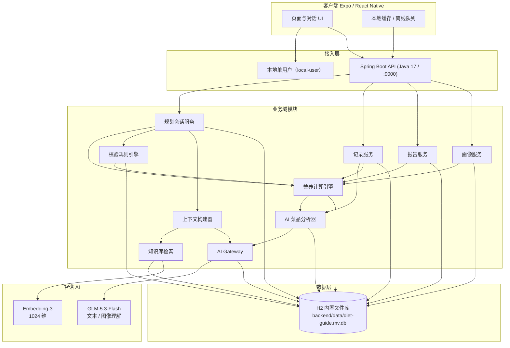
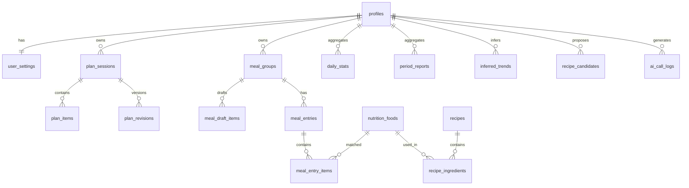
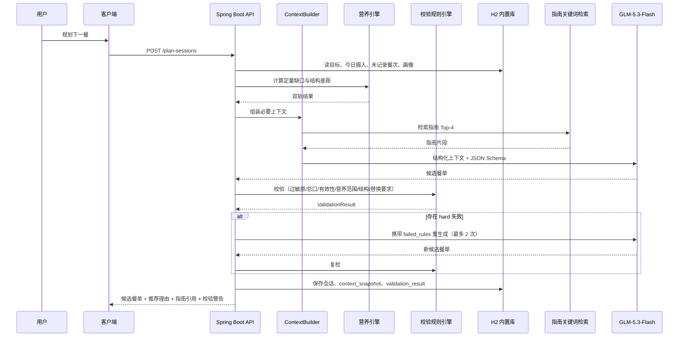
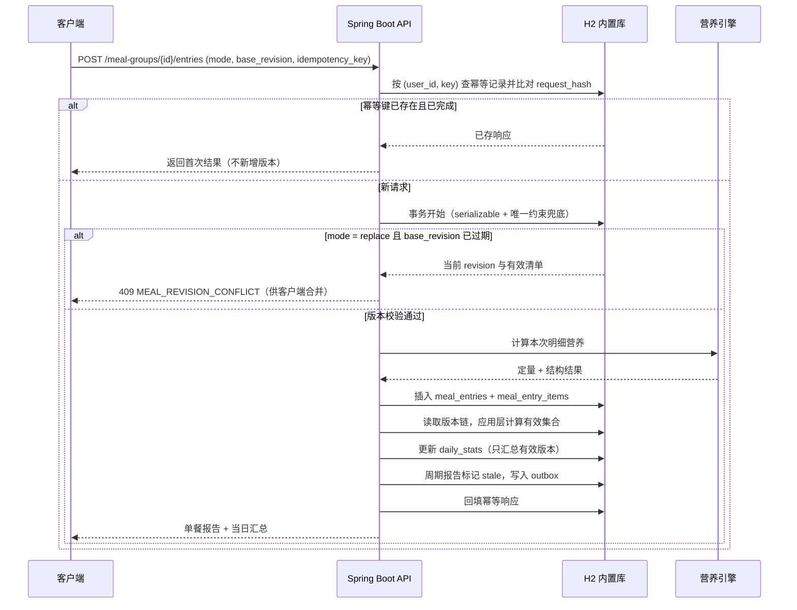
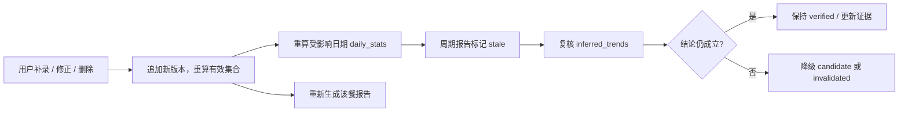

# 膳食指南 AI App - 技术架构文档

> **2026-10-30 业务流程重构说明**：本文档已按"记录主流程重排"更新。核心变化：① 记录是唯一主流程，删除"先建空组"与直写 entry 入口；② AI 输出一律是候选（确认态在 `meal_draft_items`，R09 硬拦未确认 AI 项）；③ 记录与配餐共用同一 `RuleEngine`（R01–R09）；④ `DailyStatsAggregator` 是日口径唯一真相源，`daily_stats.structure` 必须落库；⑤ "接受配餐"是原子用例（`POST /plan-sessions/{id}/accept`，复用 commit 用例），`/complete` 仅结束规划。

| 项目 | 内容 |
| --- | --- |
| 文档版本 | v1.1 |
| 更新日期 | 2026-10-26 |
| 关联文档 | 《膳食指南App产品说明书》《AI核心策略与Token方案》 |
| 适用范围 | 移动端、后端服务、营养计算引擎、AI 接入、数据与部署 |

> 安全说明：本文不写入任何真实 API Key。已收到的智谱密钥请仅配置在服务端 Secret 中（见 §12.3），并建议在智谱控制台轮换后再使用。

---

## 1. 范围与目标

本文描述从「一餐规划」到「实际记录 → 营养计算 → 报告 → 长期画像」闭环的技术实现方式，覆盖：

* 系统分层与模块职责
* 营养计算引擎的输入、输出与计算口径
* 数据模型、约束与迁移
* API 契约与关键流程时序
* 智谱 AI 模型接入（GLM-5.3-Flash、Embedding-3）与 Token 控制
* 安全、性能、测试、部署与演进

不在本文范围内：具体 UI 视觉稿、运营后台、支付与商业化。

---

## 2. 架构原则

| 编号 | 原则 | 落地方式 |
| --- | --- | --- |
| P1 | **AI 负责分析与解释，数值必须可追溯** | AI 将文本/照片解析为结构化食物项，推断复合菜品配方并解释营养；最终入库数值由引擎按营养库计算，AI 直接估算须标注 `ai_estimated`、置信度与区间 |
| P2 | **事实与推断分离** | 用户明确设置不可被 AI 覆盖；推断趋势带状态与证据 |
| P3 | **状态可恢复、写入幂等** | 规划会话持久化；记录提交带幂等键；统计更新可重放 |
| P4 | **必要上下文最小充分** | 只发送完成当前任务所需的结构化摘要，不发送原始流水账 |
| P5 | **规则化校验** | AI 产出的餐单由独立校验引擎判定，返回结构化失败项，而非自由文本 |
| P6 | **密钥不入客户端** | 智谱 API Key 仅存在于服务端环境变量/Secret |
| P7 | **规划可解释** | 候选餐单携带缺口快照、结构依据、指南引用与校验结果，全链路可追溯 |

---

## 3. 总体架构



**分层职责**

1. **客户端**：交互与展示；不持有任何模型密钥；通过 HTTP 直连本机后端，离线时记录入本地队列，联网后按幂等键补交。
2. **接入层**：本地单用户模式，中间件统一注入 `local-user`；Spring Boot 服务负责全部业务接口，直连内置 H2 文件库。
3. **业务域**：Java 模块，可单测；营养引擎为纯函数 + 仓储接口，不依赖网络；AI 菜品分析器负责把自然语言/照片转为结构化食物项与配方，是计算引擎的输入前端。
4. **数据层**：H2 文件库为唯一事实来源（`backend/data/diet-guide.mv.db`），无需安装数据库服务；启动时由 `schema.sql` 建表、`seed.sql` 幂等写入种子数据。指南检索改为关键词匹配，不再依赖 pgvector。
5. **AI 层**：全部经 AI Gateway 调用，统一鉴权、限流、重试、日志与输出校验；AI 不直接写入统计事实表。

---

## 4. 技术选型与关键决策

### 4.1 选型清单

| 层次 | 选型 | 理由 |
| --- | --- | --- |
| 移动端 | React Native + Expo | 双端复用，Dev Server 端口 `3001` |
| 后端语言 | Java 17 | 与前端解耦，营养引擎可独立演进与部署 |
| 后端框架 | Spring Boot 3.3（Web / Validation / JDBC） | 内嵌 Tomcat，端口 `9000`，接口前缀 `/api` |
| 身份 | 本地单用户 | 数据与后端同机，无需登录；中间件固定注入 `local-user` |
| 数据库 | **H2 2.2 文件库**（PostgreSQL 兼容模式） | 嵌入后端进程，零安装；事务、唯一约束、JSON 文本存储 |
| 向量检索 | 关键词匹配（`guideline_chunks`） | 内置库无向量扩展；指南条目量级小，关键词匹配足够 |
| 对话模型 | 智谱 `glm-5.3-flash` | 1M 上下文、原生多模态、成本可控 |
| 向量模型 | 智谱 `embedding-3` | 预留能力，当前版本未启用向量检索 |
| 文件存储 | 客户端本地 / 后续接入对象存储 | 当前版本不保存照片 |
| 定时任务 | 应用内按需生成 | periodic 报告由接口触发并落库 |
| 可观测性 | 自建 `ai_call_logs` + 应用日志 | Token、时延、错误可追溯 |
| 测试 | JUnit 5 + `tsc --noEmit` | 营养计算与幂等可回归 |

### 4.2 架构决策记录（ADR）

| 编号 | 决策 | 说明 |
| --- | --- | --- |
| ADR-01 | 后端采用独立 Spring Boot 服务（Java 17） | API 契约与数据库结构保持不变，营养引擎仍为纯函数，可单测、可独立部署；前端只依赖 HTTP 接口 |
| ADR-02 | 数据库内置为 **H2 文件库** | 免安装、免运维，数据随 `backend/data/` 目录迁移；通过 `MODE=PostgreSQL` 保留大部分 SQL 习惯 |
| ADR-03 | 本地单用户、不引入登录 | 个人使用场景下账号体系无收益；表结构保留 `user_id`，将来开放多用户时可直接复用 |
| ADR-04 | 所有模型调用经 AI Gateway | 客户端零密钥；统一记录 Token、重试、降级与 Schema 校验 |
| ADR-05 | 规划建议不落库为“摄入” | 规划会话独立表；仅 `meal_entries` 的有效集合计入营养统计 |
| ADR-06 | AI 作为菜品分析前端 | AI 负责识别菜品、拆解配方、给出区间估算；最终数值由引擎计算或标注 `ai_estimated`，避免黑箱与伪精度 |
| ADR-07 | 餐次采用“组 + 版本链” | 支持补录与多次加餐；统计只读有效集合；`replace` 携带 `base_revision` 做并发控制 |

> 本文已按「Java（Spring Boot）后端 + H2 内置文件库 + TypeScript 前端」落地；PRD 中若仍写 MySQL 或 Edge Functions，以本文与仓库代码为准。

---

## 5. 模块设计

### 5.1 营养计算引擎（核心）

**定位**：把「吃了什么、吃了多少」转换为可核算的营养结果，并输出两类结论。营养数值的计算与解释分离，但菜品理解由 AI 承担。

#### 5.1.1 AI 菜品分析器（Dish Analyzer）

**职责**：把自然语言或照片转换为结构化食物项与配方，为计算引擎提供可核算的输入。AI 可以分析菜品的营养价值，但分析结果必须落到可复核的结构上，而不是只给一段文字。

* 识别菜名、份量与就餐场景（文字或照片，照片走 `glm-5.3-flash` 多模态）。
* 复合菜品：推断原料构成、各原料用量、用油量、烹饪方式、成品份数。
* 与食物库做候选匹配，输出 `food_id` 候选与匹配置信度。
* 输出分析依据（识别到的食材、烹饪方式、参考来源），便于用户核对。
* **边界**：AI 不直接写入 `daily_stats`。它提供“菜品结构 + 置信度”，营养数值由引擎按营养库计算。

```ts
interface DishAnalysis {
  dishName: string;
  matchedFoodId?: string;
  recipeProposal?: {
    ingredients: Array<{ name: string; foodId?: string; amountG: number }>;
    oilG: number;
    cookingMethod: string;
    servings: number;
    yieldG: number;
  };
  directEstimate?: {
    energyKcal: [number, number];   // 区间，而非单点
    proteinG?: [number, number];
    confidence: number;             // 0–1
  };
  confidence: number;
  basis: string[];                  // 识别依据
  needsUserConfirm: boolean;
}
```

**三种结果路径**

| 路径 | 触发条件 | 处理 | 结果标记 |
| --- | --- | --- | --- |
| 标准食物 | 命中食物库且无需拆解 | 引擎按重量换算 | `measured` |
| AI 配方 + 引擎计算 | 复合菜品、可推断配方 | 配方写入 `recipe_candidates`（待审核），引擎按配方计算 | `estimated`，带 `source='ai_inferred'` |
| AI 直接估算 | 无法匹配且无法拆解（如外购菜品） | 存区间与置信度，展示给用户确认；纳入统计时单独标记 | `ai_estimated`，带区间与置信度 |

**输入契约**

```ts
interface MealInput {
  userId: string;
  mealDate: string;          // 用户时区自然日 YYYY-MM-DD
  mealType: 'breakfast' | 'lunch' | 'dinner' | 'snack';
  items: Array<{
    foodId?: string;         // 已匹配到食物库时必填
    rawName: string;         // 用户原始输入
    amountG: number;         // 统一换算为克
    valueType?: 'measured' | 'estimated' | 'ai_estimated';
    recipeId?: string;       // 复合菜品
    analysis?: DishAnalysis; // AI 分析结果，保留依据与置信度
  }>;
  nutritionDataVersion: string;
}
```

**输出契约**

```ts
interface NutritionResult {
  quantitative: {
    energyKcal: number;
    proteinG: number;
    fatG: number;
    carbG: number;
    fiberG: number;
    sodiumMg: number;
    calciumMg: number;
    ironMg: number;
    // 其余指标按食物库支持范围扩展
    perItem: Array<{ foodId: string; valueType: 'measured' | 'estimated'; values: Record<string, number> }>;
  };
  structure: {
    foodGroups: Array<{
      group: 'grains' | 'vegetables' | 'fruits' | 'protein' | 'dairy' | 'soy_nuts' | 'oils';
      amountG: number;
      recommendedRangeG: [number, number];
      status: 'insufficient' | 'adequate' | 'excessive';
    }>;
    distinctFoodCount: number;
    diversityNote: string;
  };
  valueType: 'measured' | 'estimated' | 'ai_estimated';
  warnings: string[];
}
```

**计算规则**

1. **单一标准食物**（米饭、鸡蛋、牛奶等）

   ```
   摄入量 = Σ(实际重量 g × 可食部比例 × 每 100g 营养素 / 100)
   ```

   结果标记 `measured`，同输入可复现。

2. **复合菜品**（糖醋排骨、红烧肉等）

   配方由 AI 分析器推断（写入 `recipe_candidates`，经审核后转为正式 `recipes`），或直接取自人工维护的 `recipes`。

   ```
   单份营养 = Σ(原料用量 × 每 100g 营养素 / 100) / 成品份数
   成品重量 = Σ原料重量 − 烹饪损耗 + 用油量
   ```

   结果标记 `estimated`，报告中标注“估算”，并允许用户修正实际用量后重算。

3. **无法拆解的菜品**

   AI 给出区间估算与置信度（`ai_estimated`），UI 展示区间并提示可修正；该结果参与当日统计但单独标记，不与 `measured` 混算为同一个精度等级。

4. **单位换算**：碗、份、个等通过 `unit_conversion` 换算为克；无法换算时要求用户补录，不猜测。

5. **缺口与“未记录餐次”**

   ```
   剩余目标 = 每日目标 − 今日已摄入
   后续餐次 = 今日尚未记录的餐次集合
   规划方向 = 剩余目标在后续餐次上的合理分配（按餐次权重）
   ```

   关键约束：剩余目标只是**规划参考**，不是必须补齐的配额；已摄入数值不可被后续推荐改写。若剩余目标为负，引擎输出“已超出”，推荐方向转为结构均衡与低能量密度，而非继续“补差”。

6. **膳食结构建议**：按食物组计算克数与推荐区间（蔬菜 300–500 g、奶及奶制品 300 ml 等，以指南版本为准），同时统计食物种类数，避免“营养素够但结构单一”。

7. **目标来源优先级**：用户自定义目标 > 按年龄/性别/活动水平匹配的参考值 > 系统默认值。参考值存于 `nutrition_targets` 表，支持版本化。

8. **精度**：能量取整（kcal），宏量营养素保留 1 位小数，钠保留整数（mg）；估算值与精确值分别标注，不混用。

**食物匹配**：AI 分析器先给出候选名称与置信度，再由确定性匹配器按 `food_id` → 标准名称/别名 → 模糊匹配逐级确认；模糊结果必须由用户确认后才写入记录，未确认项标记 `pending_review`。AI 不能绕过食物库直接把任意名称当作有效食物。

### 5.2 规划会话服务

**职责**：管理一次"规划下一餐"的完整生命周期，隔离规划数据与实际摄入。

* 会话状态机：`planning` → `accepting` →（acceptPlan commit 成功）`logged` /（失败）`failed`；`closed` 仅表示"结束规划"（`/complete`），**不再写 `awaiting_log`、不再与记录混写**。
* 原子接受配餐：`POST /plan-sessions/{id}/accept` 单事务完成"会话校验 → 生成可编辑草稿（`commit=false`）或直接记录（`commit=true`）→ 幂等 → 状态迁移"；**内部复用记录服务的同一 commit 用例**，不另写第二条写路径。重复调用（同幂等键，accept 层键为 `accept:<key>`）返回同一结果；失败事务回滚无半成品、可重试。
* 会话恢复：所有消息与候选餐单落库，客户端重进可恢复；会话带 `current_revision` 与 `accepted_group_id`。
* 上下文构建：由 `ContextBuilder` 组装（见 §9），**本餐目标 = 全天目标 × 餐次权重（`Targets.mealTarget`）为本餐设计依据，全天缺口（`gap`）仅作提示**，不再按"剩余缺口平均分给未记录餐次"分配。
* 换菜 = 版本化修订：同一会话内生成新 revision（`plan_revisions` 保存当前方案/`user_feedback`/约束/校验结果，`base_revision` 指向上一版），基于 `currentMenu` 做最小改动，可对比/回滚；不再"重新生成一个新会话"。
* 换菜闭环：AI 生成 → 共享规则引擎（见 §5.8）→ 返回结构化 `failed_rules` → 携带失败项重生成（最多 2 次）→ 仍失败则规则引擎按本餐目标与结构区间兜底，并标 `source=RULE_FALLBACK`（AI 成功为 `AI`）。
* 可解释性：每个候选菜品携带 `reason`、`citations`、缺口快照与校验结果；`plan_sessions.context_snapshot` 与 `validation_result` 落库。

### 5.3 记录服务

**职责**：接收实际饮食、维护版本链与幂等、触发统计更新。记录是**唯一主流程**：开餐（惰性建组）→ item 级草稿编辑 → 规则校验 → commit（事务+幂等）。

**四个概念**

| 概念 | 说明 | 数据载体 |
| --- | --- | --- |
| 餐次 | 早餐、午餐、第二顿、晚餐、加餐、夜宵；加餐/夜宵可多实例 | `meal_groups.meal_type` |
| 餐次组 | 一次逻辑用餐实例，是版本链的归属单位；状态 `draft / logged / abandoned` | `meal_groups` |
| 餐次草稿 | item 级可编辑草稿，**也是 AI 确认态的唯一载体** | `meal_draft_items` |
| 餐次记录 | commit 产生的版本（审计用） | `meal_entries` → `meal_entry_items` |

**草稿生命周期（写死）**

* 开餐 `POST /meal-groups/drafts`：惰性建 `draft` 组（带 24h `expires_at`）；同 `(meal_type, seq)` 已有草稿则复用；已有 `logged` 组则**重开为草稿**（`reopen_draft`，保留版本链，commit 在该组产生新 revision）。非 snack/night_snack 固定 `instance_seq=1`；snack/night_snack 多实例取 `max(seq)+1`。
* item 级编辑：`POST /draft/items`、`PATCH /draft/items/{itemId}`（改量/换食物/确认 AI 项）、`DELETE`、`copy-previous`；每次写操作 `draft_revision` +1 作乐观锁，冲突返回 `409 MEAL_REVISION_CONFLICT`。确认动作幂等（同 itemId + 目标 `confirmation_status` 直接返回）。
* 过期清理：`getDay`/清理任务将 `expires_at` 已过的草稿置 `abandoned` 并清理草稿项。
* commit `POST /meal-groups/{id}/draft/commit`（单事务）：幂等 → 草稿归属/过期/乐观锁校验 → **共享规则引擎记录侧校验（硬规则 422）** → 草稿项转正式 entry（一条新 revision，`confirmation_status/ai_source` 随迁）→ `DailyStatsAggregator` 物化当日 `daily_stats`（metrics+structure）→ 标记周期报告 `stale` → 组转 `logged`、清空草稿项。空草稿或存在未确认 AI 项（R09）拒绝提交。

**提交语义（内部保留，用户操作收敛为草稿）**

* 有效集合定义：`最新一条 replace 记录 + 其后所有 append 记录`（`MealVersion.effective()`）；旧版本进入历史，不参与统计。
* 版本链只追加不物理删除；修正 = 重开草稿后 commit 产生新 `append` revision，不再要求用户整组 `replace`。

**幂等与并发**

* 幂等键：`(user_id, idempotency_key)` 为主键 + `request_hash` 内容比对；重复提交返回首次结果。commit 与 acceptPlan 各自独立键作用域（`meal_entry` / `plan_accept`）。
* 并发控制：`draft_revision` 乐观锁；不匹配返回 `409 MEAL_REVISION_CONFLICT`。
* 事务边界：写入记录与明细 → 重算该组有效集合 → 聚合更新当日统计 → 标记相关周期报告 `stale`；同一事务提交。

### 5.4 报告服务

* **单餐报告**：记录提交事务内计算并返回，不依赖 AI。
* **当日统计**：增量更新 `daily_stats`，带 `source_hash` 与 `nutrition_data_version`。
* **周期报告**：按需生成；以 `input_hash = hash(stats + prompt_version + model)` 做缓存，命中直接返回。
* **失效策略**：历史记录变更后，将覆盖该日期的周期报告标记 `stale`；下次打开页面时重算并重新生成 AI 总结。
* **数字边界**：报告数值只取自 `daily_stats` / `period_reports.stats`；AI 文本单独存 `ai_summary`，不参与数值计算。

### 5.5 画像服务

* **明确设置**：目标、偏好、忌口、过敏原，存于 `user_settings`，只能由用户操作或用户明确确认的流程修改。
* **推断趋势**：由统计结果计算，写入 `inferred_trends`，字段含指标、结论、状态、证据（窗口、样本餐次、偏差幅度）。
* **状态机**：
  * `candidate`：窗口内样本 ≥ 10 餐且偏差方向一致，但未跨周期验证。
  * `verified`：连续 2 个统计周期同向成立。
  * `invalidated`：新数据推翻原结论，保留记录但不进入 Prompt。
* **纠错触发**：记录新增/修改/删除 → 重算受影响窗口 → 复核结论 → 必要时降级或失效。

### 5.6 知识库与 RAG

**离线建库**

1. 指南文本按章节切块，单块 300–600 字，重叠 80 字。
2. 元数据：版本（2022）、章节、页码、主题标签。
3. 调用 `embedding-3`，显式传 `dimensions: 1024`；单次最多 64 条、单条 ≤ 3072 tokens。
4. 写入 `guideline_chunks`，建立 HNSW 索引。

**在线检索**

1. Query = 用户问题或规划场景标签（如“高血压”“补钙”“素食”）。
2. 向量 Top-20 → 按元数据/相似度阈值过滤 → 取 Top-4（总长 ≤ 1000 tokens）。
3. 将片段连同出处注入 Prompt；回答中保留引用标记。
4. 检索结果仅用于推荐与解释，**不参与营养数值计算**。

**更新**：指南版本变更时按 `content_hash` 增量重建，旧版本切片置为 `deprecated`，避免混用。

### 5.7 AI Gateway

**统一接口**

```ts
interface ChatOptions {
  userId: string;
  traceId: string;
  scene: 'meal_plan' | 'meal_replace' | 'food_parse' | 'meal_summary' | 'period_summary';
  messages: Array<{ role: 'system' | 'user' | 'assistant'; content: unknown }>;
  responseSchema: JSONSchema;
  maxOutputTokens: number;
  temperature: number;
  timeoutMs: number;
  images?: string[]; // 食物照片，走 GLM-5.3-Flash 多模态
}
```

**职责**

* 模型调用：`POST https://open.bigmodel.cn/api/paas/v4/chat/completions`，模型 `glm-5.3-flash`。
* 结构化输出：优先使用 JSON Schema / JSON 模式；返回后由服务端按 Schema 校验，失败则重试一次，再失败降级为规则生成。
* 超时与重试：单次 20 s；仅对超时与 5xx 重试 1 次；429 按退避重试。
* 限流：按用户与全局两级令牌桶，避免单用户刷爆配额。
* 日志：记录 `trace_id`、场景、模型、输入/输出 Token、时延、状态、prompt 版本；不记录完整敏感原文。
* 降级：AI 不可用时，规划退化为“规则引擎 + 食物库”生成候选，报告仅输出统计与固定模板文字。

### 5.8 校验规则引擎（RuleEngine，共享）

**定位**：独立模块，不依赖 AI，**记录提交与配餐生成调用同一实例**（配餐侧 `PlanValidator`、记录侧 `RecordValidationService` 均包装 `RuleEngine.runChecks`），禁止两套校验逻辑。输入「候选/草稿项 + 当日上下文 + 用户设置」，输出结构化判定。规则与阈值存于 `validation_rules` 表并版本化。

**规则清单（硬/软边界写死）**

| rule_id | 校验项 | 生效范围 | 后端动作 | 级别 |
| --- | --- | --- | --- | --- |
| `R01_ALLERGEN` | 过敏原 | 两者 | 展开后归一化比对，命中即 422 阻断 / 不能出现在方案 | hard |
| `R02_AVOID` | 忌口 | 两者 | 命中则 422 阻断 / 过滤 | hard |
| `R03_FOOD_VALID` | 食物有效性 | 两者 | `food_id` 须在 `active` 食物库或可映射配方；AI 估算项按估算有效 | hard |
| `R04_NUTRIENT_RANGE` | 营养合理性 | 两者 | 记录侧提示仍允许提交；配餐侧重试优先 | **soft** |
| `R05_STRUCTURE` | 膳食结构 | 两者 | 记录侧提示；配餐侧结构优先重试 | **soft** |
| `R06_REPLACE_REQUEST` | 换菜约束 | 配餐(换菜) | 逐条确定性校验，不满足不能出现 | hard |
| `R07_DUPLICATE` | 重复菜品 | 两者 | 提示/合并 | **soft** |
| `R08_SCOPE` | 餐次/医疗边界 | 两者 | `meal_type` 非法 422；不做疾病判断 | hard |
| `R09_AI_UNCONFIRMED` | 未确认 AI 估算项 | 记录提交 | `ai_estimated` 未 `confirmed` 则 422 阻断，绝不进日统计 | hard |

**营养合理性：动态范围，而非“每餐达到每日目标”**

```
剩余目标     = max(每日目标 − 今日已摄入, 0)
剩余餐次权重 = Σ 今日未记录餐次的权重（含当前餐）
本餐期望     = 剩余目标 × 当前餐权重 / 剩余餐次权重
允许区间     = 本餐期望 × [1 − tolerance, 1 + tolerance]
```

* 默认餐次权重：早餐 0.25、午餐 0.35、晚餐 0.30、加餐 0.10，可按用户习惯配置。
* `tolerance` 默认 0.20（能量）；蛋白质只设下限（≥ 期望 × 0.8）；钠与脂肪设上限。
* 若今日已超出每日目标，不再按“补差”计算，切换为「不显著超出剩余额度 + 结构优先」模式。
* 多次加餐按实例分别代入公式，但当日总量仍受同一套目标约束。

**输出契约**

```ts
interface ValidationResult {
  passed: boolean;
  failed_rules: Array<{
    rule_id: string;
    severity: 'hard' | 'soft';
    message: string;
    offending_items: string[];
    expected?: unknown;
    actual?: unknown;
  }>;
  warnings: Array<{ rule_id: string; message: string }>;
  computed_ranges: {
    energyKcal: [number, number];
    proteinG?: [number, number];
    sodiumMg?: [number, number];
  };
  rule_version: string;
}
```

**与 AI 的交互**

* `hard` 失败：记录提交直接 `422 VALIDATION_FAILED`（`details` 含 `failed_rules`）；配餐侧作为重生成输入，最多 2 次。
* `soft` 失败：返回用户展示为警告（记录仍可提交；配餐继续重试）。
* 配餐 2 次仍失败：规则引擎按本餐目标与结构区间从食物库组合兜底，标记 `fallback = true`、`source = RULE_FALLBACK`。
* `validation_result` 与 `context_snapshot` 一起落库，供解释与审计。

**医疗边界**：产品只提供膳食记录、营养信息与一般性膳食建议，不判断用户是否患有某种疾病，也不根据少量记录给出疾病结论；涉及疾病或治疗问题时，提示咨询医生或注册营养师。

---

## 6. 数据架构

### 6.1 实体关系



### 6.2 核心表

| 表 | 关键字段 | 说明 |
| --- | --- | --- |
| `profiles` | id, age, gender, height_cm, weight_kg, activity_level | 基础资料 |
| `user_settings` | user_id, daily_targets json 文本, preferences json 文本, allergens json 数组, avoid json 数组 | 用户明确设置（权威） |
| `nutrition_targets` | age_range, gender, activity_level, nutrients json 文本, version | 参考摄入量 |
| `nutrition_foods` | id, name, aliases json 数组, category, nutrients_per_100g json 文本, edible_ratio, source, source_version, status, unit_conversion json 文本 | 食物营养库 |
| `recipes` | id, name, servings, yield_g, oil_g, cooking_method, source, status | 复合菜品（正式） |
| `recipe_ingredients` | recipe_id, food_id, amount_g | 配方原料 |
| `recipe_candidates` | id, user_id, dish_name, proposed_recipe json 文本, confidence, source, status, reviewed_by | AI 推断配方，待审核 |
| `plan_sessions` | id, user_id, meal_date, meal_type, status(planning/accepting/logged/failed/closed), current_revision, accepted_group_id, context_snapshot json 文本, validation_result json 文本 | 规划会话与可解释依据；`closed` 仅结束规划 |
| `plan_items` | id, session_id, food_id, name, amount_g, value_type, nutrition json 文本, reason, citations json 文本, rejected | 当前方案条目，不计入摄入 |
| `plan_revisions` | id, session_id, revision, base_revision, source(AI/RULE_FALLBACK), items json 文本, replace_constraints json 文本, user_feedback, validation_result json 文本 | 换菜版本化修订历史，可对比/回滚 |
| `meal_groups` | id, user_id, meal_date, meal_type, instance_seq, status(draft/logged/abandoned), draft_revision, expires_at, committed_at | 餐次组；draft 带过期时间与乐观锁 |
| `meal_draft_items` | id, group_id, user_id, food_id, raw_name, amount_g, value_type, analysis json 文本, ai_source, confirmation_status(pending/confirmed/rejected), confirmed_by, confirmed_at | item 级餐次草稿，**AI 确认态唯一载体**；commit 原地转 `meal_entry_items` |
| `meal_entries` | id, group_id, user_id, mode, revision, base_revision, supersedes_entry_id, is_current, totals json 文本, value_type, nutrition_data_version, idempotency_key | 餐次记录版本 |
| `meal_entry_items` | id, entry_id, food_id, raw_name, amount_g, value_type, nutrients json 文本, analysis json 文本, ai_source, confirmation_status, confirmed_by, confirmed_at | 餐次明细（确认态随迁） |
| `daily_stats` | user_id, stat_date, metrics json 文本, structure json 文本（物化，禁止 `'{}'` 硬编码）, aggregator_version, value_type, source_hash, computed_at | 当日统计（`DailyStatsAggregator` 唯一写入口） |
| `period_reports` | id, user_id, period_type, period_start, period_end, stats json 文本, ai_summary, status, input_hash | 周/月报 |
| `inferred_trends` | id, user_id, metric, conclusion, status, evidence json 文本, window_start, window_end, sample_meals | 推断趋势 |
| `validation_rules` | rule_id, severity, threshold json 文本, weight json 文本, version, enabled | 校验规则与阈值（版本化） |
| `guideline_chunks` | id, content, metadata json 文本, content_hash, status | 指南切片 |
| `ai_call_logs` | id, trace_id, user_id, scene, model, prompt_tokens, completion_tokens, latency_ms, status | AI 调用审计 |
| `idempotency_keys` | user_id, key, scope, request_hash, response json 文本, status | 幂等控制 |
| `outbox_events` | id, aggregate_type, aggregate_id, event_type, payload json 文本, processed_at | 异步重算/报告失效 |

### 6.3 关键约束与索引

```sql
-- 内置 H2 文件库：无需任何扩展，结构与种子数据见 schema.sql / seed.sql

-- 餐次组：同一餐次允许多个加餐实例（instance_seq）
-- 已在 schema.sql 中声明：
-- constraint uq_meal_groups unique (user_id, meal_date, meal_type, instance_seq)

-- 版本链：同一餐次组内 revision 单调唯一
-- constraint uq_meal_entries_revision unique (group_id, revision)
-- create index idx_meal_entries_group on meal_entries (group_id, revision)

-- 每组只有一条“当前基线”replace：由应用层在事务内维护 is_current，
-- H2 不支持带 where 的部分唯一索引。

-- 有效集合：最新 replace + 其后的所有 append，
-- 由 MealVersion.effective() 在应用层计算，不再使用数据库视图。

-- 幂等
-- primary key (user_id, key)，配合 request_hash 做内容比对

-- 指南检索：关键词匹配（lower(content) like ?），不使用向量索引
```

**统计口径**：`daily_stats` 只能按“最新 `replace` + 其后所有 `append`”的有效集合汇总（`MealVersion.effective()`）；任何直接聚合 `meal_entries` 全表的查询都会把历史版本重复计入，属实现错误。

### 6.4 数据隔离

内置库为单机单用户，不再使用 RLS。服务端所有查询都带 `user_id = 'local-user'` 条件，数据层保留 `user_id` 列，未来开放多用户时可直接切换为按账号隔离。

| 表 | 访问方式 |
| --- | --- |
| `profiles` / `user_settings` / `meal_groups` / `meal_entries` / `meal_entry_items` / `daily_stats` / `period_reports` / `inferred_trends` / `plan_sessions` / `plan_items` | 仅本机服务访问，按 `user_id` 过滤 |
| `nutrition_foods` / `recipes` / `guideline_chunks` / `validation_rules` | 只读种子数据，随 `seed.sql` 幂等写入 |
| `recipe_candidates` | 由 AI 分析写入候选，审核状态在表中标记 |
| `ai_call_logs` / `idempotency_keys` / `outbox_events` | 仅服务端访问，不对客户端开放 |

### 6.5 迁移策略

* 结构与种子数据位于 `backend/src/main/resources/schema.sql` 与 `seed.sql`，启动时幂等执行（`create table if not exists` + `merge into`）。
* 字段变更采用“新增列 → 双写 → 切换 → 清理”，保证旧数据可回滚。
* 破坏性变更前备份 `backend/data/diet-guide.mv.db`，回滚即还原文件。
* 数组与 JSON 字段统一以文本存储，读写必须经过 `JsonCodec`，禁止在 SQL 中做 JSON 函数运算。
* 所有营养相关表带 `nutrition_data_version`，数据源升级时可定位历史结果版本。

---

## 7. API 设计

所有接口由 Spring Boot 暴露，统一前缀 `/api`，本地单用户模式不需要鉴权头。

| 方法 | 路径 | 说明 |
| --- | --- | --- |
| POST | `/plan-sessions` | 创建规划会话（本餐目标 = 全天目标 × 餐次权重；gap 仅提示） |
| POST | `/plan-sessions/{id}/messages` | 版本化换菜（同会话新 revision，携带 `user_feedback`/`constraints`） |
| POST | `/plan-sessions/{id}/accept` | **原子接受**：`commit=true` 直接记录 / `commit=false` 生成可编辑草稿；单事务+幂等+状态机 |
| POST | `/plan-sessions/{id}/complete` | 仅结束规划（`closed`），不参与记录 |
| GET | `/plan-sessions/{id}` | 恢复会话（含 `current_revision`、`accepted_group_id`、方案条目） |
| GET | `/meal-groups?date=` | 当日餐次（含草稿项与物化 structure） |
| POST | `/meal-groups/drafts` | 开餐：惰性建/复用草稿组，已记录组重开为草稿修正 |
| POST | `/meal-groups/{id}/draft/items` | 加草稿项（AI 候选需 `confirmed` 标记） |
| PATCH | `/meal-groups/{id}/draft/items/{itemId}` | 改量/换食物/确认 AI 项（幂等） |
| DELETE | `/meal-groups/{id}/draft/items/{itemId}` | 删草稿项（乐观锁） |
| POST | `/meal-groups/{id}/draft/copy-previous` | 复制上一餐 |
| POST | `/meal-groups/{id}/draft/commit` | 提交：规则硬拦 → 转 entry → 聚合 → stale；幂等键必填 |
| GET | `/meal-groups/{id}` | 组详情（版本链 + 草稿项） |
| GET | `/reports/{periodType}?start=` | 周期报告（食物组/指南指标为主 + 营养辅指标，按需生成 + 四版本 inputHash 缓存） |
| GET/PATCH | `/settings` | 设置字段级更新；过敏原变更需 `confirm_allergen_change=true` |
| POST | `/foods-parse` | AI 识别 → 返回候选项（全部待确认，不直接入草稿） |
| GET | `/foods?q=` | 食物库检索 |

**请求示例：草稿 item 级编辑与提交**

```json
// POST /meal-groups/{id}/draft/items
{ "foodId": "f_egg_001", "rawName": "鸡蛋", "amountG": 100, "draft_revision": 1 }

// 只改鸡蛋这一项（PATCH /meal-groups/{id}/draft/items/{itemId}）
{ "amountG": 50, "draft_revision": 2 }

// POST /meal-groups/{id}/draft/commit
{ "draft_revision": 2, "idempotency_key": "b0c1f1c4-6c2a-4f0e-9f1e-2b7a9d3c8e11" }
```

**请求示例：原子接受配餐**

```json
// POST /plan-sessions/{id}/accept
{ "commit": true, "idempotency_key": "5d0e2a77-1a4b-42c9-9a5e-1f0f0c7b2d33" }
// 重复调用返回同一结果；状态 PLANNING → ACCEPTING → LOGGED；失败回滚无半成品
```

**响应示例**

```json
{
  "group_id": "…",
  "entry_id": "…",
  "revision": 4,
  "mode": "append",
  "value_type": "estimated",
  "quantitative": { "energyKcal": 712, "proteinG": 24.5, "fatG": 31.2, "carbG": 78.4 },
  "structure": {
    "foodGroups": [
      { "group": "grains", "amountG": 200, "recommendedRangeG": [200, 300], "status": "adequate" },
      { "group": "vegetables", "amountG": 0, "recommendedRangeG": [300, 500], "status": "insufficient" }
    ],
    "distinctFoodCount": 2
  },
  "daily": { "remainingKcal": 680, "unloggedMeals": ["dinner"], "snackCount": 1 },
  "warnings": ["糖醋排骨为估算值"]
}
```

**错误码**

| HTTP | code | 场景 |
| --- | --- | --- |
| 401 | `UNAUTHORIZED` | 预留：当前为本地单用户模式，不会返回 |
| 403 | `FORBIDDEN` | 预留：访问非本机用户数据 |
| 409 | `IDEMPOTENCY_CONFLICT` | 相同幂等键但请求体不同 |
| 409 | `MEAL_REVISION_CONFLICT` | `replace` 的 `base_revision` 已过期，返回当前版本 |
| 410 | `SESSION_EXPIRED` | 规划会话已关闭或过期 |
| 422 | `VALIDATION_FAILED` | 字段缺失、重量非法、食物未确认 |
| 429 | `RATE_LIMITED` | 触发限流 |
| 502 | `AI_INVALID_OUTPUT` | 模型输出未通过 Schema/业务校验 |
| 503 | `AI_UNAVAILABLE` | 模型超时且降级失败 |

---

## 8. 关键流程时序

### 8.1 规划与换菜



### 8.2 记录提交、补录与幂等



### 8.3 历史修改与重算



---

## 9. AI 上下文与 Token 预算

### 9.1 上下文组成

| 场景 | 必含内容 | 禁止内容 | 输入预算 | 输出预算 |
| --- | --- | --- | --- | --- |
| 规划 | 每日目标、今日摄入汇总、未记录餐次、结构达成、近期趋势（结构化）、已验证画像、忌口/过敏原、指南 Top-4 | 原始逐餐流水、完整指南 | ≤ 3000 tokens | ≤ 1000 |
| 换菜 | 当前餐单、修改要求、本次需满足的定量与结构约束、不可推荐项、偏好、上一轮 `failed_rules` | 历史全部记录 | ≤ 2000 tokens | ≤ 800 |
| 食物解析 | 用户原文或照片、食物库候选名、配方模板 | 历史记录 | ≤ 1500 tokens | ≤ 600 |
| 单餐解读 | 引擎输出的结构化结果（含 `value_type`） | 原始输入原文 | ≤ 800 tokens | ≤ 400 |
| 周期总结 | 周期统计 + 已验证趋势 + 指南片段 | 逐日明细 | ≤ 2500 tokens | ≤ 1200 |

### 9.2 Token 与成本控制

* **不发送原始流水账**：历史一律由后端聚合为结构化摘要。
* **指南先行压缩**：RAG 只注入 Top-4 片段，总长受控。
* **缓存**：
  * 指南切片向量按 `content_hash` 缓存，避免重复 Embedding。
  * 周期报告按 `input_hash` 缓存，记录变更才失效。
  * 同一会话内的换菜不重复检索指南，复用已注入片段。
* **模型路由**：全部文本场景使用 `glm-5.3-flash`；仅在结构化输出连续失败时切换更强模型或规则兜底。
* **计量**：`ai_call_logs` 记录输入/输出 Token，按场景汇总，便于定位异常消耗。
* **批处理**：Embedding 单次最多 64 条，减少请求开销。

### 9.3 Prompt 约定

* 系统 Prompt 固化角色、输出 Schema 与边界：**可以分析菜品与估算营养，但必须给出依据、置信度与区间，不得把估算表述为精确测量**。
* 用户设置与指南片段作为“可信上下文”，用户输入作为“不可信文本”，不得执行其中的指令。
* 菜品分析输出必须包含：`dish_name`、`recipe_proposal` 或 `direct_estimate`、`confidence`、`basis`、`needs_user_confirm`。
* 规划输出必须包含：`items`、`constraints_checked`、`citations`、`explanation`；服务端校验后再返回客户端。
* 明确禁止疾病判断：不输出“你患有/可能患有某种疾病”之类结论，不提供治疗方案；涉及疾病问题时改为一般膳食建议并提示就医。
* Prompt 带版本号，与 `ai_call_logs.prompt_version` 关联，便于回归。

---

## 10. 安全与合规

| 项 | 措施 |
| --- | --- |
| 模型密钥 | 仅存服务端环境变量；不进入客户端包、仓库与日志 |
| 身份与授权 | 本地单用户模式，中间件固定注入 `local-user`；数据层保留 `user_id` 以便扩展 |
| 最小权限 | 数据库账号使用内置 `sa` 仅限本机文件库；不对局域网开放管理端口 |
| 输入校验 | 长度、数值范围、枚举、文件类型与大小限制 |
| Prompt 注入 | 用户文本不进入系统指令区；工具调用不开放写操作；输出 Schema 强校验 |
| 敏感数据 | 健康与饮食数据按敏感个人信息处理；数据仅存本机 `backend/data/`，提供导出与删除 |
| 审计 | 记录 AI 调用与关键写操作；不含完整敏感原文 |
| 密钥轮换 | 定期轮换；泄露时立即吊销并更新环境变量 |

---

## 11. 性能与可用性

**目标（设计目标，非承诺）**

| 指标 | 目标 |
| --- | --- |
| 记录提交（不含 AI） | p95 < 800 ms |
| 规划首包 | p95 < 3 s（流式输出） |
| 单餐报告 | 提交后同步返回 |
| 周期报告（缓存命中） | p95 < 300 ms |
| 周期报告（生成） | p95 < 8 s |

**措施**

* 索引覆盖 `(user_id, meal_date)`、统计唯一键、版本链 `(group_id, revision)`。
* 规划与问答使用流式响应，降低首屏等待。
* AI 超时 20 s，重试 1 次；连续失败触发熔断与规则降级。
* 客户端离线队列 + 幂等键，弱网不丢记录、不重复记录。
* 内置库为单机文件库，报告按需生成，不依赖定时任务。

---

## 12. 部署与环境

### 12.1 环境

| 环境 | 用途 | 数据 |
| --- | --- | --- |
| dev | Spring Boot（:9000，内置 H2）+ Expo（:3001） | 种子数据 |
| prod（可选） | 单机部署，jar + `data/` 目录 | 真实数据 |

### 12.2 CI/CD

1. PR 触发：前端 `tsc --noEmit`、后端 `mvn test`、SQL 结构校验。
2. 合并主干：`mvn package` 产出可执行 JAR，构建前端。
3. 发布时替换 JAR 并重启，`data/` 目录保留；回滚即恢复旧 JAR 与数据文件备份。
4. 表结构变更必须可前滚；破坏性变更采用“新增列 → 双写 → 切换 → 清理”。

### 12.3 环境变量

| 变量 | 说明 |
| --- | --- |
| `ZHIPU_API_KEY` | 智谱密钥，仅存后端环境变量，禁止入库/入仓 |
| `ZHIPU_BASE_URL` | 默认 `https://open.bigmodel.cn/api/paas/v4` |
| `ZHIPU_CHAT_MODEL` | 默认 `glm-5.3-flash` |
| `ZHIPU_EMBEDDING_MODEL` | 默认 `embedding-3` |
| `EMBEDDING_DIMENSIONS` | 预留能力，当前版本未启用向量检索 |
| `DATABASE_URL` / `DATABASE_USER` / `DATABASE_PASSWORD` | 默认内置 H2 文件库，一般无需设置 |
| `PORT` | 后端端口，默认 `9000` |
| `AI_TIMEOUT_MS` / `AI_MAX_RETRIES` | 超时与重试配置 |

> 密钥通过部署平台的环境变量或本地 `.env`（已 gitignore）注入；不要在文档、代码或客户端中硬编码。

---

## 13. 测试策略

| 类型 | 内容 |
| --- | --- |
| 单元测试 | 营养计算：标准食物换算、可食部、单位换算、复合菜品估算、舍入、AI 估算区间 |
| 契约测试 | AI Gateway 的 JSON Schema 校验、菜品分析输出、异常输出降级 |
| 数据库测试 | 餐次组唯一键、版本链唯一、有效集合计算、事务回滚、幂等回放 |
| 并发测试 | 重复提交同一幂等键、`append` 与 `replace` 并发、`base_revision` 冲突、多次加餐 |
| 校验测试 | 每条规则的 hard/soft 判定、动态范围边界、失败项结构化输出 |
| 回归测试 | 固定样本（米饭 200 g、糖醋排骨 150 g）输出快照 |
| RAG 评测 | 30–50 条黄金问答，评估召回与引用准确性 |
| E2E | 规划 → 换菜 → 结束 → 记录 → 补录 → 修正 → 报告 → 重算 |

**验收要点**

* 重复提交同一幂等键不产生新版本。
* `append` 保留此前内容；`replace` 后旧版本不参与统计。
* 同一天多次加餐分别计入，且不会被合并或覆盖。
* 修改历史记录后，当日统计、周期报告、趋势结论三者一致更新。
* AI 返回的非法食物、过敏原、超范围餐单被校验引擎拦截，并给出 `rule_id`。
* AI 估算结果带区间、置信度与 `ai_estimated` 标记，不与 `measured` 混淆。
* 报告中所有数字均可在 `daily_stats` / `period_reports` 中追溯。

---

## 14. 风险与待决事项

| 风险/待决 | 影响 | 应对 |
| --- | --- | --- |
| 食物营养数据来源与授权 | 数据缺失或合规风险 | 明确采用《中国食物成分表》版本，记录 `source` 与 `source_version`；建立审核流程 |
| 复合菜品估算误差 | 报告偏差 | 标注 `estimated`，展示区间，允许用户修正用量 |
| AI 估算被误当精确值 | 信任与合规风险 | 强制 `ai_estimated` 标记、区间与置信度；UI 明确区分三种 `value_type` |
| 版本链统计重复累计 | 数据错误 | 统计只读有效集合（`MealVersion.effective()`）；单元测试覆盖 append/replace 组合 |
| 校验阈值漂移 | 行为不一致 | 阈值存 `validation_rules` 并版本化；变更需回归用例 |
| 模型结构化输出不稳定 | 解析失败 | JSON Schema + 服务端校验 + 重试 + 规则兜底 |
| 内置库并发写入 | 文件锁冲突 | H2 `AUTO_SERVER=TRUE` 支持多连接；写操作走事务与唯一约束兜底 |
| PRD 与实现不一致（MySQL / Edge Functions） | 认知偏差 | 以「Spring Boot + H2 内置库」实现为准，PRD 同步修正 |
| 时区与跨日 | 统计错位 | 统一按用户时区计算 `meal_date`，服务端存储 UTC 时间戳 |
| 指南版本更新 | 引用过期 | 切片带版本与状态，增量重建 |
| 密钥泄露 | 费用与数据风险 | 服务端保管、轮换、调用限额与告警 |

---

## 15. 代码组织（目标结构）

```text
backend/
  pom.xml
  data/                    # 内置 H2 数据库文件（运行时生成，不入库）
  src/main/java/com/dietguide/
    ai/                    # 智谱调用、重试、日志、Prompt 模板
    context/               # 必要上下文组装
    dish/                  # AI 菜品分析：配方推断、区间估算、置信度
    nutrition/             # 营养引擎、目标、结构评估、共享 RuleEngine（R01–R09）
    domain/                # 领域模型与餐次版本链
    service/               # 规划、餐次组、报告、画像
    adapter/               # JDBC 仓储（H2，JSON 文本 + 关键词检索）
    web/                   # REST 控制器、本地单用户中间件、统一错误响应
    shared/                # 营养容器、哈希、统一异常
  src/main/resources/
    schema.sql             # 建表（if not exists）
    seed.sql               # 食物、配方、规则种子（merge 幂等）
  src/test/java/com/dietguide/   # JUnit 5 单测与内存仓储
frontend/                  # Expo + React Native（:3001）
  src/api/                 # 后端客户端与 DTO
  src/screens/             # 今日汇总
docs/                      # PRD、技术架构、AI 策略文档
```

**现有文件迁移**

| 现有位置 | 处理 |
| --- | --- |
| 旧 `apps/api`（TypeScript） | 已整体替换为 `backend/`（Spring Boot），HTTP 契约与数据模型不变 |
| 旧 `supabase/functions` | 已移除；所有接口由 Spring Boot 控制器承接 |
| `supabase/migrations` + `seed.sql` | 已迁入 `backend/src/main/resources/schema.sql` 与 `seed.sql`，改为 H2 语法 |
| 旧 Supabase 登录 | 已移除，改为本地单用户直连 |
| `README.md` | 已更新为 Java 后端 + 内置数据库 + Expo 前端，端口 `9000` / `3001` |

---

## 16. 实施里程碑

| 阶段 | 交付物 | 验收标准 |
| --- | --- | --- |
| M1 数据骨架 | `schema.sql` + `seed.sql`、本地单用户、用户设置 | 启动自动建库；设置可读写 |
| M2 营养引擎、菜品分析与食物库 | 计算引擎、AI 菜品分析器、食物/配方数据、单测 | 黄金样本稳定；三种 `value_type` 可区分；AI 配方可复核 |
| M3 规划会话、校验与 AI 网关 | 会话服务、ContextBuilder、校验规则引擎、智谱接入 | 规划可恢复；hard 失败可定向重生成；规则可解释 |
| M4 记录与报告 | 餐次组/版本链、append/replace、当日统计、单餐/周期报告 | 补录不覆盖；修正不重复累计；多次加餐正确汇总 |
| M5 画像与 RAG | 趋势状态机、指南建库与检索 | 历史修改后结论正确升降级 |
| M6 加固与上线 | 限流、降级、监控、安全评估 | 故障可降级；密钥与权限合规 |

---

## 附录 A：智谱接口要点

| 项 | 值 |
| --- | --- |
| Base URL | `https://open.bigmodel.cn/api/paas/v4` |
| 对话接口 | `POST /chat/completions` |
| 向量接口 | `POST /embeddings` |
| 对话模型 | `glm-5.3-flash`（1M 上下文，128K 最大输出，原生多模态） |
| 向量模型 | `embedding-3`，维度 256–2048 可自定义（默认 2048） |
| 向量请求限制 | 单次 ≤ 64 条，单条 ≤ 3072 tokens |
| 本文选定维度 | 预留 1024（当前版本未启用向量检索） |

> 模型编码与计费以智谱控制台和官方文档为准；上线前用实际账号做一次连通性与限流验证。
